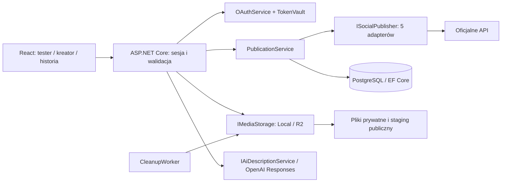

# Architektura PUBLICATE

> Aktualny punkt wejścia (14.11.2026): [PROJECT_CONTEXT](../PROJECT_CONTEXT.md) i [WORKSPACES](WORKSPACES.md). Ten dokument zachowuje starszy opis projektu; istnieje obecnie sześć adapterów, w tym osobny XPublisher i YouTube/YouTubeUpload. TikTok wysyła PULL_FROM_URL. PKCE wdrożono także dla YouTube. Aktualne szkice mają 48 h od utworzenia i maks. 10/użytkownika; poniższy opis ogólnej retencji nie zastępuje reguł szkiców. Rozdzielenie projektów nie zmienia architektury monolitu ani schematu DB.

> Aktualizacja 2026-11-05: działa rejestracja i logowanie e-mail/hasło, bez AccessKey. Zasoby należą do zalogowanego użytkownika, OAuth state jest związany z jego sesją. Pełny opis: [USER_ACCOUNTS](USER_ACCOUNTS.md).

## Moduły i granice

Unified Login: `ConnectedAccount.AuthMethod` oraz migracja InstagramAuthMethod oddzielają tokeny Unified od Direct. Unikalność konta obejmuje metodę autoryzacji. Cele mają Kind=InstagramUnified, a ich token pochodzi z konta. Host publikacji wybierany jest z zapisanej metody, nie z aktualnego domyślnego trybu połączeń. Ponowne discovery unieważnia cele niepotwierdzone przez API. Direct pozostaje obsługiwany dla wcześniejszych aplikacji; wymagania scopes zależą od metody konta.

Instagram używa niezależnego Instagram Login (`InstagramLogin.cs`, osobne `Providers:Instagram`). Facebook korzysta z `Providers:Meta`. Bezpośrednie cele IG mają `Kind=InstagramLogin` i korzystają z zaszyfrowanego tokenu konta, bez kopii Page tokenu. Pozostałe stare cele IG są ukryte i odrzucane przez adapter; wymagane ponowne połączenie, historia pozostaje. Późniejsza migracja Unified Login dodaje AuthMethod — patrz opis powyżej. `graph.instagram.com` obsługuje zarówno tworzenie kontenerów, publikację, jak i status. Żadna operacja IG nie tworzy konta ani celu Facebooka.

Jeden proces ASP.NET Core i jeden frontend React. PostgreSQL zapewnia trwałość metadanych, historię i ograniczenia unikalności. .NET 10 LTS wybrano ze względu na wsparcie; nie ma mikroserwisów ani brokera wiadomości. Vite przekazuje `/api` do backendu, dzięki czemu przeglądarka nie przechowuje tokenów dostawców.

`Domain.cs`: osiem encji wymaganych w specyfikacji. `Database.cs` i `Migrations`: relacje i migracje. `OAuthService`: connect, discovery, access/refresh, disconnect. `ISocialPublisher`: capabilities, validation, publish i status; operacje kont delegowane do OAuthService zamiast powtarzania ich w pięciu adapterach. `ProviderHttp`: transport przez HttpClientFactory, bez automatycznych redirectów i retry. `PublicationService`: snapshoty, kontrola idempotencji, trwałe joby i próby. `MediaStorage`: lokalny magazyn/R2, ffprobe, reguły retencji. `AiDescriptions`: opcjonalne wywołanie multimodalne.

## Dane i własność

Users → ConnectedAccounts → PublishingTargets. Posts → PostVariants → PublicationJobs → PublicationAttempts. MediaAssets są współdzielone przez uporządkowane tablice UUID w Posts/PostVariants/PublicationJobs. Tablice wybrano, aby nie dodawać tabel łącznikowych w PoC; ich integralność i właściciel są sprawdzane w aplikacji. Klucze obce chronią pozostałe relacje. Przed komercjalizacją należy rozważyć tabele referencji dla integralności DB i wydajniejszych zapytań retencji.

Wszystkie zasoby mają OwnerId pobrany z sesji zalogowanego użytkownika PUBLICATE. Rejestracja i logowanie używają e-maila i hasła. Endpointy nie przyjmują właściciela od klienta. Model pozwala na wiele kont tej samej platformy, wiele celów i wiele wariantów. Stary użytkownik testowy pozostał w bazie bez możliwości logowania; jego dane nie są automatycznie przypisywane nowym kontom. Przed produkcją potrzebne są m.in. reset hasła, weryfikacja e-mail i MFA.

## Dziedziczenie i snapshot

`null` w DescriptionOverride/CtaOverride/MediaOverride oznacza dziedziczenie. Pusty tekst lub pusta tablica to świadome usunięcie wartości, nie dziedziczenie. Zmiana bazy nie usuwa nadpisań. Kolejność plików wynika z kolejności identyfikatorów. Operacja publikacji zapisuje niezmienny snapshot treści, wybranych plików i ustawień oraz nazwę celu.

## Publikacja i niepewność

Walidacja lokalna przed operacją nie dowodzi dostępu do produktu. Po zgodzie użytkownika tworzony jest PublicationJob przed pierwszym efektem zewnętrznym. RequestKey jest unikalny dla właściciela i zwraca istniejący job po powtórzeniu tego samego żądania. Częściowy indeks unikalny dla VariantId blokuje równoległe/niepewne/zakończone sukcesem publikacje tego samego wariantu. Docelowo ponowny świadomy post to nowy post bazowy.

Unknown jest wynikiem timeout, zerwanego połączenia, brakującego potwierdzenia lub przerwania procesu po rozpoczęciu operacji. Nie jest automatycznie ponawiany. Po restarcie Uploading/Publishing przechodzą w Unknown. Processing oznacza znane zadanie dostawcy, które jeszcze nie potwierdziło publikacji. `OperationId` kontenera/uploadu jest oddzielny od `ExternalId` posta.

Sukces LinkedIn: 201 i x-restli-id. Facebook feed: ID odpowiedzi tworzenia. Instagram: ID odpowiedzi media_publish, nigdy samo ID kontenera. TikTok: PUBLISH_COMPLETE (prywatny post może nie zwracać publicznego ID). Facebook film: status ready i published. Status check nie publikuje. Jeśli przetwarzanie kontenera przekroczy krótki okres oczekiwania, UI umożliwia sprawdzenie stanu; po potwierdzeniu, że finalna publikacja nie została rozpoczęta, dopuszcza nową ręczną próbę. Nie wdrożono trwałego wznowienia uploadu częściowego.

PoC wykonuje operację w obsługiwanym żądaniu z timeoutem 5 minut niezależnym od zamknięcia przeglądarki. Globalny gate koordynuje mutacje i cleanup w jednym procesie. **Uruchamiaj jedną instancję backendu**. Wieloprocesowe dzierżawy, kolejka durable worker i transactional outbox są w roadmapie.

## Tokeny i transport

OAuth state: kryptograficznie losowy, 10 minut, jednorazowy, związany z HttpOnly cookie konkretnej przeglądarki i platformą oraz zalogowanym użytkownikiem. Callback wymaga tej samej tożsamości PUBLICATE. PKCE S256 w X. Dla pozostałych confidential web flows używany jest client secret i dokładnie skonfigurowany callback; obsługi PKCE nie zgadujemy. State znika po restarcie — trzeba zacząć OAuth od nowa.

Tokeny są szyfrowane Data Protection, wykluczone z JSON. Odczyt zakresów Meta przez me/permissions; LinkedIn przez introspectToken. Brak odpowiedzi scope nie jest uznawany za nadanie zgody. Refresh token jest wymieniany i rotowany, jeśli dostawca go zwróci. Meta i konta bez refresh token wymagają ponownego OAuth. Lokalny disconnect usuwa tokeny; cofnięcie zgody w panelu dostawcy opisano w konfiguracji.

Brak logowania treści żądań OAuth i surowych odpowiedzi. Diagnostyka przechowuje status HTTP, allowlistowany kod błędu, stan, czas i bezpieczny opis, bez arbitralnego komunikatu dostawcy. Włączony rate limit, kontrola Origin i wymagany custom header dla mutacji. Publiczny media endpoint odczytuje tylko losowe klucze istniejących, jawnie udostępnionych i kompletnie wgranych plików. Upload URL od dostawcy jest sprawdzany względem HTTPS i allowlisty hostów; nie ma endpointu do pobierania dowolnego URL użytkownika.

## Retencja

Plik tymczasowy trafia do prywatnego stagingu, jest sprawdzany przez ffprobe, a rekord MediaAsset zapisany przed zapisem docelowego obiektu. `Uploaded=false` uniemożliwia wykorzystanie niedokończonego uploadu; taki obiekt nadal można posprzątać. Lokalny staging po awarii jest sprzątany po okresie bezpieczeństwa. R2 używa prywatnego bucketu i kopii w odrębnym publicznym bucketcie dopiero po zgodzie na udostępnienie.

Cleanup co godzinę. Każde niepewne lub aktywne zadanie przypinające plik blokuje usunięcie bez ograniczenia czasu — bezpieczeństwo publikacji jest ważniejsze niż limit retencji. Zakończone operacje mają minimum konfigurowalnych 48 h. Referencja w szkicu chroni plik do limitu nieaktywności (domyślnie 30 dni); potem pojawia się ostrzeżenie i minimum 24 h na zapis/odnowienie. Zapis lub użycie odnawia LastUsedAt i usuwa ostrzeżenie. Usunięcie zachowuje metadane i historię. Nie konfiguruj ślepego lifecycle kasującego aktywne obiekty niezależnie od aplikacji.
